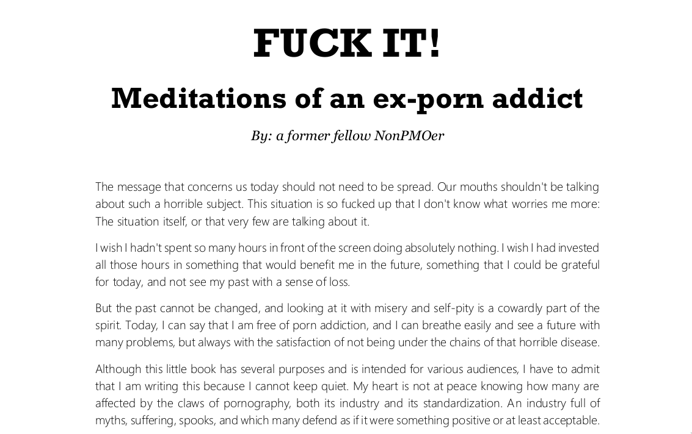
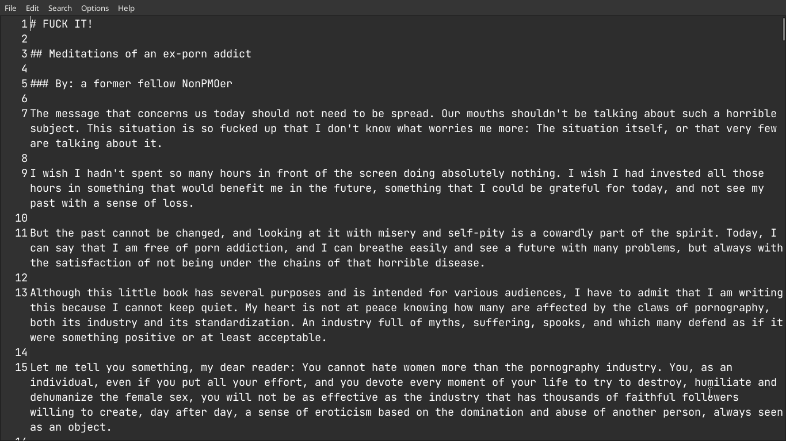

# PDF to Formatted Markdown CLI (pdf2md)

Công cụ CLI viết bằng Python, giúp chuyển đổi PDF dạng digital (có text layer và metadata font) sang Markdown sạch, có cấu trúc rõ ràng.

Ví dụ, đây là một trang PDF chẳng hạn:



Output sẽ kiểu như này:



*Tất nhiên là do bản thân PDF này nó đã sạch rồi nên chuyển đổi trông output markdown nhìn cực ưng ý*

## Cài đặt

### Yêu cầu

- Python 3.8 trở lên.
- Các thư viện Python: `pymupdf` (fitz), `pdfplumber` và `typer`.

### Cài đặt

1. Tải hoặc clone dự án về máy:

   ```bash
   git clone <repository_url> pdf2md-cli
   cd pdf2md-cli
   ```

2. Tạo môi trường ảo (venv) và cài đặt các thư viện phụ thuộc:

   ```bash
   python3 -m venv .venv
   source .venv/bin/activate  # Trên Windows dùng `.venv\Scripts\activate`
   pip install --upgrade pip
   pip install pymupdf pdfplumber typer pytest
   ```

### Sử dụng

Chuyển PDF sang Markdown

```bash
# Chạy luồng chuyển đổi mặc định. Nếu không chỉ định file đầu ra, kết quả sẽ được ghi vào file `<ten_file_dau_vao>.md`.
python3 -m pdf2md input.pdf
# Thêm tên tệp output
python3 -m pdf2md input.pdf output.md
# Quên hết thông tin về cái script này trong lúc dùng?
python3 -m pdf2md --help
```

## License

*Dự án này được phát hành theo giấy phép Unlicense.*
